# Camp Directory Builder — User Manual

This manual walks you through every part of Camp Directory Builder, from preparing your files to printing the finished directory. It assumes no technical background. Wherever a technical term or abbreviation comes up, it's explained right there.

*Every screenshot in this manual uses made-up sample people ("Pinecrest Camp"), not real campers.*

---

## Contents

1. [What the app does](#what-the-app-does)
2. [What you'll need](#what-youll-need)
3. [Opening the app](#opening-the-app)
4. [Preparing your roster CSV](#preparing-your-roster-csv)
5. [Preparing your photos](#preparing-your-photos)
6. [Step 1 — Camp Details](#step-1--camp-details)
7. [Step 2 — Roster CSV](#step-2--roster-csv)
8. [Step 3 — Photos](#step-3--photos)
9. [Editing a photo](#editing-a-photo)
10. [Editing a listing](#editing-a-listing)
11. [Saving your edits](#saving-your-edits)
12. [Downloading all photos](#downloading-all-photos)
13. [Step 4 — Export](#step-4--export)
14. [What the finished directory looks like](#what-the-finished-directory-looks-like)
15. [Printing tips](#printing-tips)
16. [Troubleshooting](#troubleshooting)
17. [Frequently asked questions](#frequently-asked-questions)
18. [Glossary](#glossary)

---

## What the app does

Making a camp directory by hand means copying and pasting dozens (or hundreds) of names, photos, and bios into a layout program, then fixing everything when one person's listing pushes the whole page out of place.

Camp Directory Builder does that work for you. It takes:

- **a roster** (a spreadsheet of everyone's details), and
- **photos** — either a PDF where each person's photo is on a page with their name, or a folder of photo files named after each person,

…matches each photo to the right person, and produces a finished, two-column directory PDF ready to print.

**Everything happens inside your web browser on your own computer.** Your files are never uploaded anywhere.

---

## What you'll need

- **A computer, iPad, or iPhone** with a modern web browser — Safari, Chrome, Firefox, or Edge.
- **An internet connection** when you first open the app. The app downloads a few helper tools it needs to read and create PDFs. (Your files are *not* sent over the internet.)
- **Your roster**, saved as a CSV file. See [Preparing your roster CSV](#preparing-your-roster-csv).
- **Your photos**, as a PDF or a folder of image files. See [Preparing your photos](#preparing-your-photos).
- *(Optional)* **A cover photo** — a JPG or PNG image for the front of the directory.

> **JPG and PNG** are the two most common picture file types. Photos from phones and cameras are usually JPG (sometimes spelled JPEG, for *Joint Photographic Experts Group*, the committee that created it). PNG (*Portable Network Graphics*) is common for screenshots and graphics.

---

## Opening the app

1. Find the file `camp-directory-builder.html` (in your Downloads folder, or wherever you saved it).
2. **Double-click it.** It opens in your default web browser.

That's it — there's nothing to install.

**On an iPhone or iPad:** save the file to the Files app, tap it, then tap the Share button and choose to open it in Safari. Or, if your group has put the app online (see the README's "Putting it online" section), just visit the web link.

This is what you'll see:


Across the top is a row of four numbered tabs:

**1 Camp Details · 2 Roster CSV · 3 Photos · 4 Export**

You'll work through them left to right. The tab you're on is highlighted, and finished steps turn green. Once you've reached a step, you can click its tab to jump back to it at any time.

---

## Preparing your roster CSV

### What is a CSV?

**CSV** stands for **Comma-Separated Values**. It's a plain, simple version of a spreadsheet: each row is one line of text, and the columns are separated by commas. Every spreadsheet program can save one:

- **Excel:** File → Save As → choose **CSV UTF-8 (Comma delimited)**.
- **Numbers (Mac):** File → Export To → **CSV…**
- **Google Sheets:** File → Download → **Comma Separated Values (.csv)**.

> **UTF-8** is a way of storing text that handles accented letters (é, ñ, ü) and other special characters correctly. If you have a choice, pick UTF-8.

### Required layout

- **Row 1 must contain the column headings.**
- **Every row after that is one person.**
- Blank rows are ignored.

### Column headings the app recognizes

| Column heading | What to put in it | Example |
|---|---|---|
| `First Name` | First name | `Avery` |
| `Last Name` | Last name | `Lindqvist` |
| `Date of Birth` | Full date **or** just month and day | `2009-03-14` or `11-05` |
| `Registrations` | Any text containing the word "Camper" or "Staff" | `Pinecrest 2026 - Camper` |
| `GI Address` | Street address | `12 Alder Way` |
| `GI City` | City | `Portland` |
| `GI State/Province` | State or province | `OR` |
| `GI Email` | Email address | `avery.l@example.com` |
| `GI Phone` | Phone number | `503-555-0141` |
| `GI Host Family` | `Yes` if they're a host family | `Yes` |
| `GI Directory Bio` | Their short self-description | `I'm into bouldering, terrible puns…` |

**Only First Name and Last Name are truly required.** Leave any other column empty and that detail simply won't appear in that person's listing.

> **Why "GI"?** It stands for "General Information" — the prefix used by the registration system NBTSC exports from. The app is forgiving: it also recognizes plainer headings such as `Email`, `Phone`, `City`, `Bio`, `DOB`, or `Group`. Still, the headings in the table are the safest choice, and they're what the app uses when it saves your edits.

### How Camper vs. Staff is decided

The app reads the `Registrations` column for each person:

- If it contains the word **"Staff"** (and not "Camper") → the person goes in the **Staff** section.
- If it contains **"Camper"** (and not "Staff") → **Campers**.
- If it contains **both** words, or **neither** → the app puts them in **Campers** to be safe, and tells you it guessed.

Capital letters don't matter. You can always change anyone's group by hand in Step 2.

### Tips

- **Bios with commas, quotation marks, or line breaks are fine.** Spreadsheet programs automatically wrap those in quotes when saving a CSV, and the app reads them correctly.
- **Emoji (😀 🌲) will be removed** from the printed directory. The fonts used in the PDF can't display them. Everything else in the bio stays.
- If you've used the app before and clicked **Save Edits to CSV**, you can load that saved file here — it uses exactly the right headings.

---

## Preparing your photos

You can give the app photos in either of two ways.

### Option A: a photo PDF

A PDF where **each person's photo sits on a page together with their printed name**. Many registration and yearbook tools can export something like this — for example, one page per person with a photo and a line like *"Name: Avery Lindqvist  Date of Birth: …"*.

The app works through the PDF page by page:

1. It **pulls out the photo** on each page (the actual image, not a screenshot of the whole page). Tiny images such as logos and icons are skipped.
2. It **reads the text** on that page to find a name. It looks first for a "Name:" label, and otherwise uses the first line that looks like a person's name.
3. It **compares that name to your roster** to decide who the photo belongs to.

For best results:

- **One person per page.**
- **The name on the page should match the roster** as closely as possible. Small differences are OK — the app uses "fuzzy matching," which means it can tell that "Feliks Nakamura" probably means "Felix Nakamura."
- **The PDF needs real text, not a picture of text.** If you can click and highlight the name in a PDF viewer, you're fine. If you can't, the app won't be able to read names automatically — but you can still assign photos by hand.
- **Accented letters can trip it up.** The app stops reading a name at letters like ø, é, or ñ, so "Lena Sørensen" is read as "Lena S" and won't match automatically. You'll simply assign that photo by hand (it takes a couple of seconds).

### Option B: a folder of photo files

A folder of JPG or PNG files, **each named after the person in it**, for example:

```
Avery_Lindqvist.jpg
Bodhi-Marchetti.jpg
Celeste Okonkwo.png
```

Underscores ( _ ) and dashes ( - ) are treated as spaces, so all three styles above work. The same fuzzy matching applies, so a small spelling slip is fine.

> **Note:** choosing a whole folder works on a Mac or PC, but not on an iPhone or iPad. On those devices, use a photo PDF instead.

You can even use both: load a PDF, then a folder (or vice versa). The app adds the new photos to the ones it already has.

---

## Step 1 — Camp Details

This page sets up everything about the directory itself: its title, cover, and look.

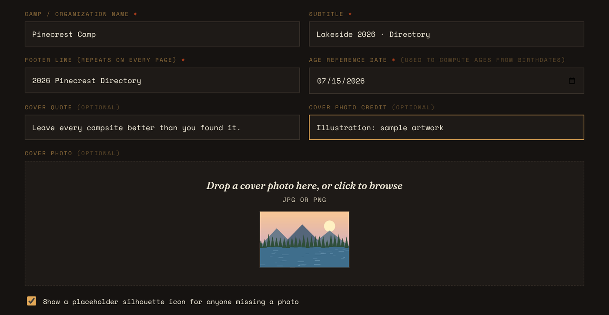

### Basic information

Fields with a small red star ( * ) are the important ones. The others are optional.

| Field | What it does |
|---|---|
| **Camp / Organization Name** * | The big title on the cover, and part of the header on every page. |
| **Subtitle** * | Appears under the name on the cover and alongside it in page headers. Example: *Lakeside 2026 · Directory*. |
| **Footer line** * | A short line repeated at the bottom-right of every page. Example: *2026 Pinecrest Directory*. |
| **Age reference date** * | The date the app uses to work out everyone's age. It's set to **today** automatically. Change it to the first day of camp if you want ages to be right for camp week. Click the little calendar icon to pick a date. |
| **Cover quote** *(optional)* | A quotation printed in italics under the cover photo. |
| **Cover photo credit** *(optional)* | Gives credit to whoever took the cover photo. Printed in small type under the quote. |
| **Cover photo** *(optional)* | Drag a JPG or PNG onto the box, or click the box to choose a file. A small preview appears once it's loaded. |

### Placeholder silhouette

**"Show a placeholder silhouette icon for anyone missing a photo"** — when this box is ticked (the default), anyone without a photo gets a simple gray head-and-shoulders shape in their photo square. Untick it to leave the square empty instead.

### Typography (fonts and sizes)

"Typography" just means the style and size of the lettering. Scroll down on the Camp Details page to find these settings:

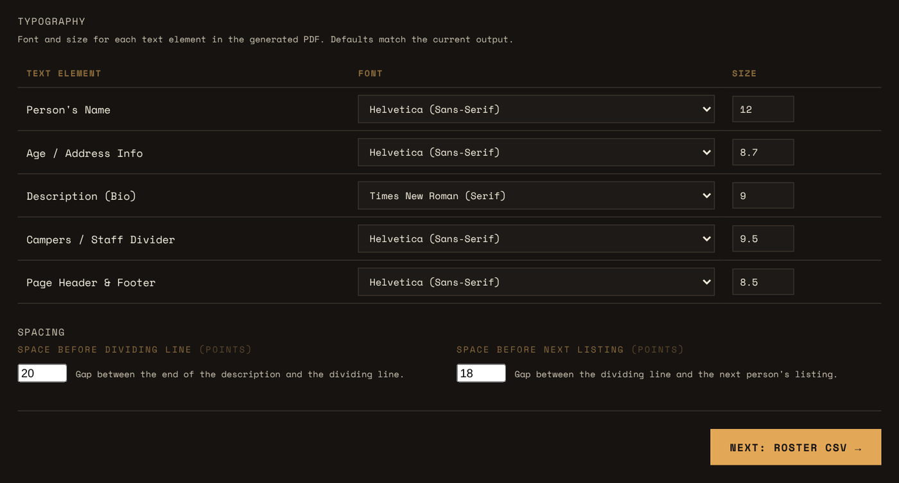

You can set a font and size for five parts of the directory:

| Part of the directory | Default font | Default size |
|---|---|---|
| Person's Name | Helvetica (sans-serif), bold | 12 |
| Age / Address Info | Helvetica (sans-serif) | 8.7 |
| Description (Bio) | Times New Roman (serif) | 9 |
| Campers / Staff Divider | Helvetica (sans-serif), bold | 9.5 |
| Page Header & Footer | Helvetica (sans-serif) | 8.5 |

The font choices are **Times New Roman**, **Helvetica**, and **Courier**:

- **Serif** fonts (like Times New Roman) have small "feet" on the ends of the letters. They're traditional and easy to read in long paragraphs.
- **Sans-serif** fonts (like Helvetica) don't have those feet ("sans" is French for "without"). They look clean and modern and are great for names and labels.
- **Courier** looks like an old typewriter. Every letter takes up the same width.

These three fonts are built into every PDF reader in the world, so your directory will look exactly the same on every computer and printer.

**Sizes are in "points."** A point is a printing measurement: 72 points = 1 inch. Most books use 10–12 point text. You can type sizes with a decimal (like 8.7) for fine control, or use the small up/down arrows in the box.

**If you don't touch any of these, you get the default design.**

### Spacing

Two settings control the breathing room between listings, both measured in points:

| Setting | What it controls | Default |
|---|---|---|
| **Space before dividing line** | The gap between the end of someone's bio and the thin line beneath it. This is the blank area people can use for handwritten notes. | 20 |
| **Space before next listing** | The gap between that line and the start of the next person. | 18 |

Bigger numbers = more writing space, but fewer people per page (so more pages to print).

### Moving on

Click **Next: Roster CSV →** at the bottom of the page.

If any of the starred fields are empty, a message pops up listing what's missing and asking if you want to continue anyway. Click **OK** to move on — those parts will just be blank in the PDF until you come back and fill them in — or **Cancel** to stay and fill them in now.

> **Important — changing settings later:** the app saves your Camp Details settings at the moment you click **Next: Roster CSV →**. If you go back to Step 1 later to change a font, the title, or the spacing, **click Next: Roster CSV → again** afterwards so the change is picked up. Your roster and photos stay loaded when you do this.

---

## Step 2 — Roster CSV

1. **Drag your CSV file** onto the box that says *"Drop your roster CSV here, or click to browse"* — or click the box and choose the file.
2. The app reads it right away. Below the box you'll see a status line such as *"Loaded 12 people from sample-roster.csv."*

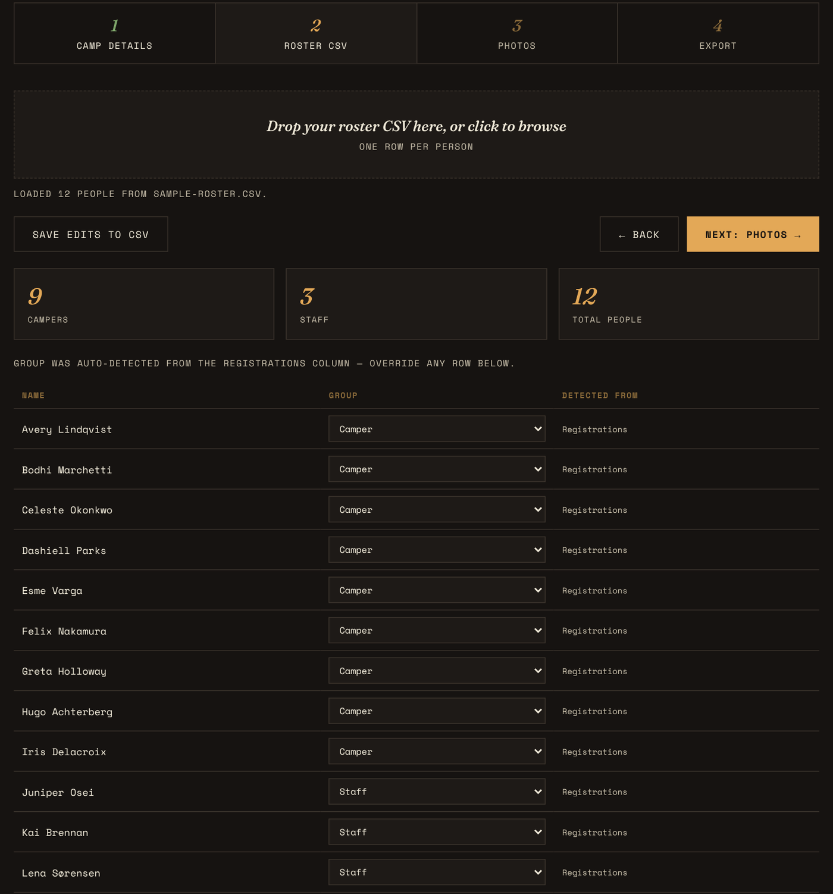

Under the status line you'll find:

- **A row of buttons:** **Save Edits to CSV** on the left (see [Saving your edits](#saving-your-edits)), and **← Back** and **Next: Photos →** on the right.
- **Three summary boxes:**
  - **Campers** — how many people were placed in the Campers group.
  - **Staff** — how many were placed in Staff.
  - **Total People** — everyone together.
- **A table listing every person**, with three columns:
  - **Name**
  - **Group** — a dropdown showing Camper or Staff. **Change it here** if the app guessed wrong; the counts update straight away.
  - **Detected From** — tells you *how* the app chose the group:
    - *Registrations* — it found "Camper" or "Staff" in the Registrations column.
    - *Registrations (both found, defaulted)* — it found both words, so it chose Camper. Worth double-checking.
    - *no match, defaulted* — it found neither word, so it chose Camper. Worth double-checking.
    - *manually edited* — you changed this person's group in the listing editor.

When it all looks right, click **Next: Photos →**. There's a Next button both above and below the list, so you don't have to scroll to the bottom of a long roster.

---

## Step 3 — Photos

### Loading photos

The Photos page has two drop areas, side by side:

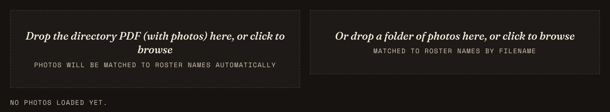

- **Left:** drag your **photo PDF** here (or click to choose it).
- **Right:** drag a **folder of photos** here (or click to choose a folder).

For a PDF, a progress panel appears with a spinning film-reel icon. It shows the file name, which page it's reading, and a progress bar:

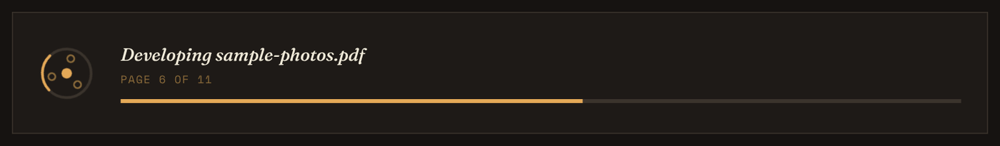

Large PDFs can take a minute or two — let it finish.

The app also tries to **straighten sideways photos automatically**. Some PDFs store photos rotated and only *display* them upright; the app works out the correct direction and fixes it. If a photo still comes out sideways, you can rotate it yourself (see [Editing a photo](#editing-a-photo)).

### The buttons at the top

When the photos are loaded, a row of buttons appears:


- **Save Edits to CSV** — see [Saving your edits](#saving-your-edits).
- **Download All Photos** — see [Downloading all photos](#downloading-all-photos).
- **← Back** and **Next: Generate →**.

Below them are three summary boxes:

- **Matched** — people who now have a photo.
- **No Photo** — people still without one.
- **Photos Extracted** — the total number of photos the app has found so far.

### Reviewing the matches

Below the summary boxes is the review table, sorted by first name. Each row is one person:


| Column | What it shows / does |
|---|---|
| *(thumbnail)* | A small preview of their photo, if they have one. |
| **Name** | The person's name. |
| **Group** | Camper or Staff. |
| **Match** | A colored label showing how the photo was matched (see below). |
| **Photo** | A dropdown listing every photo the app found, by the name it read for each one. Use it to **assign the right photo** to anyone marked "no photo," or to fix a wrong match. |
| **Edit Photo** | Opens the photo editor. It says **Add Photo** if the person doesn't have one yet. |
| **Edit** | Opens the listing editor to change this person's text details. |

**What the Match labels mean:**

- 🟩 **MATCHED** (green) — the name on the photo matched the roster exactly.
- 🟨 **FUZZY MATCH** (yellow) — the names were close but not identical (in the picture, the PDF said "Feliks" and the roster says "Felix"). Glance at the thumbnail to make sure it's the right person. Photos you've picked from the dropdown or imported yourself also show this yellow label.
- 🟥 **NO PHOTO** (red) — no photo has been matched yet.

**About the Photo dropdown:** if a photo is already being used by someone else, the dropdown shows "— in use" after its name. If you pick it anyway, it moves to the new person, and the previous person goes back to "no photo." Choosing **— No photo —** removes a person's photo.

In the example above, Greta has no photo at all, and Lena's photo is in the PDF but wasn't matched automatically because of the "ø" in her name. The app read her name only as far as the "ø", so her photo is listed in the dropdowns as **"Lena S"**. Fixing her takes one step: open her Photo dropdown and choose **Lena S**.

**Work down the list** and fix anyone marked "no photo" or anyone whose fuzzy match looks wrong. When you're done, click **Next: Generate →** (available above and below the table).

---

## Editing a photo

Click **Edit Photo** (or **Add Photo**) on anyone's row. A window opens showing their full photo with a **square frame** on top. Whatever's inside the square is what appears in the directory.

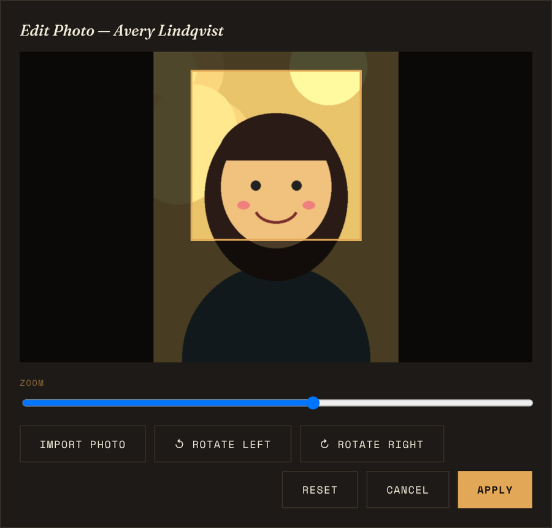

| Control | What it does |
|---|---|
| **Drag the square** | Move it to choose which part of the photo to keep. Works with a mouse, a trackpad, or your finger on a touch screen. |
| **Zoom slider** | Slide left to make the square smaller and zoom in closer on a face; slide right to show more of the photo. |
| **Import Photo** | Replace the photo with a different picture from your computer. The app automatically labels it with this person's name, so the file's original name doesn't matter. |
| **↺ Rotate Left** | Turn the photo a quarter-turn counterclockwise. |
| **↻ Rotate Right** | Turn the photo a quarter-turn clockwise. |
| **Reset** | Undo any rotation and put the square back to the full, centered view. |
| **Cancel** | Close without saving changes. |
| **Apply** | Save your changes and close. |

**If someone has no photo at all**, the window says *"No photo yet"*. Only **Import Photo** and **Cancel** work until you add one:

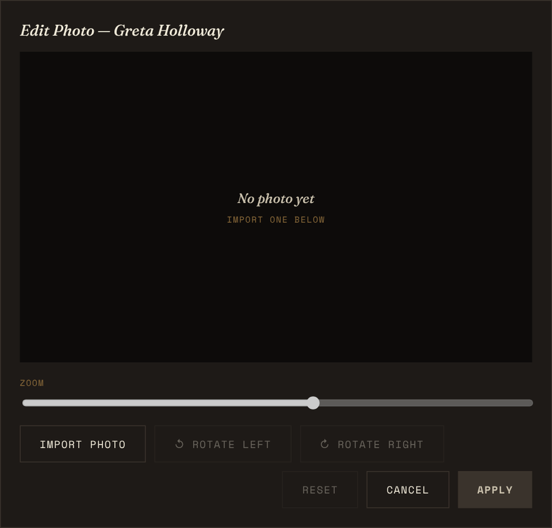

Click **Import Photo**, choose a picture, adjust the square, then click **Apply**.

Your crop and rotation changes only affect that one person's square in the directory — your original PDF or photo files are never changed.

---

## Editing a listing

Click **Edit** on anyone's row to open the listing editor. It shows every piece of text that appears in their directory entry:

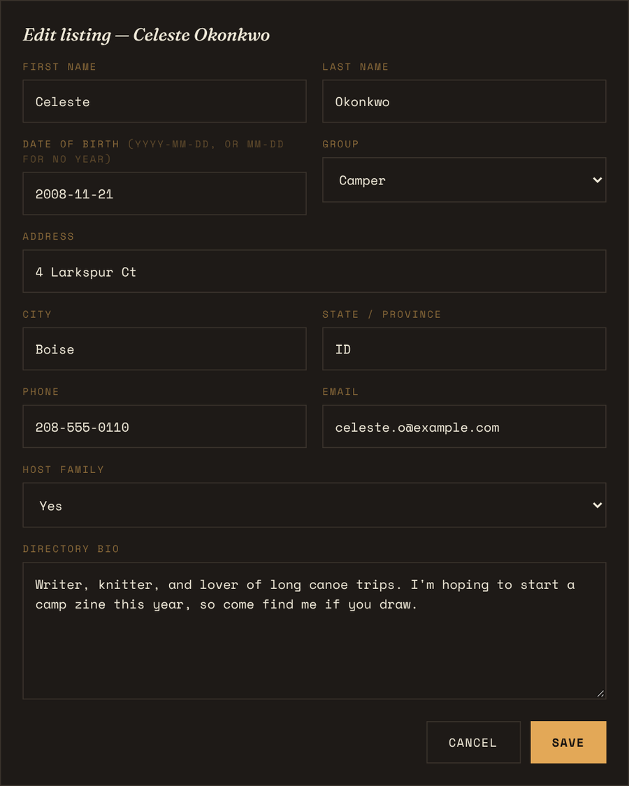

- **First Name** and **Last Name**
- **Date of Birth** — type it as `YYYY-MM-DD` (year-month-day, e.g. `2008-11-21`), or as `MM-DD` (month-day, e.g. `11-05`) if you only know the birthday and not the year.
- **Group** — Camper or Staff
- **Address**, **City**, **State / Province**
- **Phone** and **Email**
- **Host Family** — Yes or No
- **Directory Bio** — their description. The box can be made taller by dragging its bottom-right corner.

Click **Save** to keep your changes or **Cancel** to throw them away.

> **How ages appear:** if a full birthdate is given, the listing shows something like *Age 17 · Nov 21, 2008*, calculated as of the **age reference date** from Step 1. If only a month and day are given, it shows *Birthday: Nov 5*.

Edits you make here live inside the app while it's open. **To keep them for next time, use Save Edits to CSV** (next section).

---

## Saving your edits

The app doesn't remember anything once you close the browser tab. To protect your work, click **Save Edits to CSV** (at the top of the Roster CSV and Photos pages).

This downloads a new CSV file containing the whole roster **including every change you've made** — group changes, fixed typos, updated bios, and so on. The file is named with the date and time, for example:

`roster_edits_2026-07-20_1432.csv`

(That's July 20, 2026, at 2:32 pm. The time uses the 24-hour clock.)

Next time, load this file in Step 2 instead of the original. It uses exactly the column headings the app expects, so everything comes back in correctly.

> **Note:** photos, crops, and rotations aren't stored in the CSV — a CSV can only hold text. To keep your finished photos, use **Download All Photos**.

---

## Downloading all photos

**Download All Photos** (at the top of the Photos page) saves every matched photo — *with your crops and rotations applied* — into a single **ZIP file**. While it works, the button counts up, for example *"Zipping (4/10)…"*.

> **ZIP** is a way of packing many files into one compressed bundle, like putting lots of papers into a single envelope. Double-click a ZIP on a Mac or PC to open it and see the files inside.

The ZIP is named with the date and time, like `directory_photos_2026-07-20_1432.zip`. Inside, each photo is a square JPG named after its person, such as `Avery_Lindqvist.jpg`.

This is a handy way to keep a tidy, ready-to-use photo set. Next year, you can drop that folder of photos straight into the **folder** drop area in Step 3 — the file names already match the roster.

---

## Step 4 — Export

The Export page shows a final summary — how many **Campers**, how many **Staff**, and how many people have **photos** — then the **Generate Directory PDF** button.

Click **Generate Directory PDF**. A progress panel shows what the app is doing (building the cover, preparing photos, laying out campers, laying out staff) with a progress bar. When it's done:

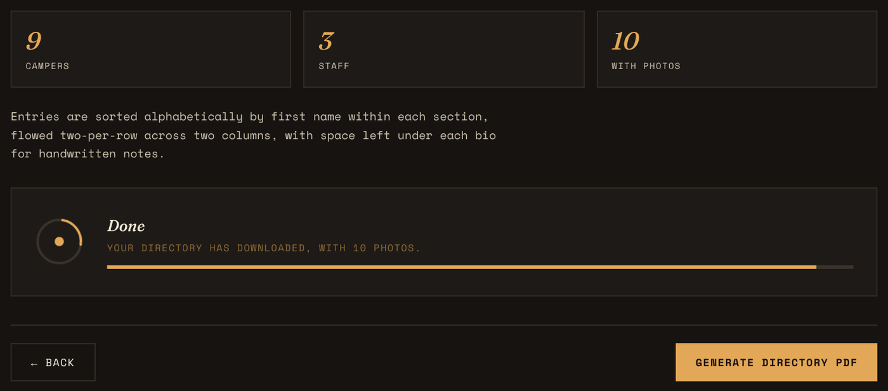

- **The PDF downloads automatically** to your Downloads folder. It's named after your camp — for example, `Pinecrest Camp.pdf`.
- The panel says **Done**, with a message confirming how many photos were included, e.g. *"Your directory has downloaded, with 10 photos."*
- **If some photos couldn't be included**, the message tells you how many, and names the first one that failed, so you can go back and fix it.

Open the PDF to check it. If you want to change anything, go back to any earlier tab, make the change, and generate again. It only takes a few seconds. (Remember: for Step 1 changes, click **Next: Roster CSV →** again before generating.)

---

## What the finished directory looks like

Here are the pages produced from the sample data:

<table>
  <tr>
    <td>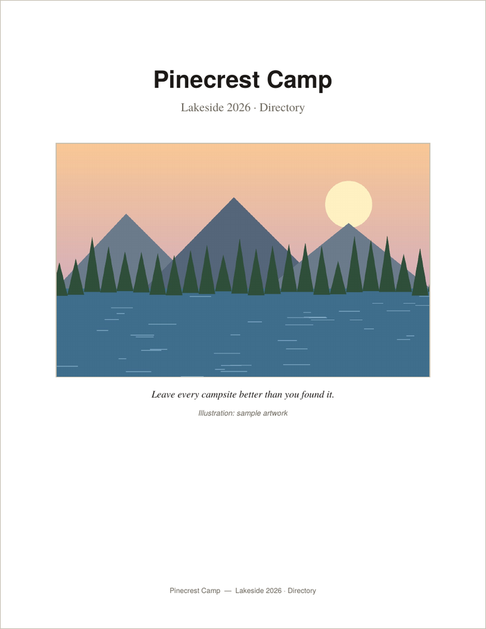</td>
    <td></td>
    <td>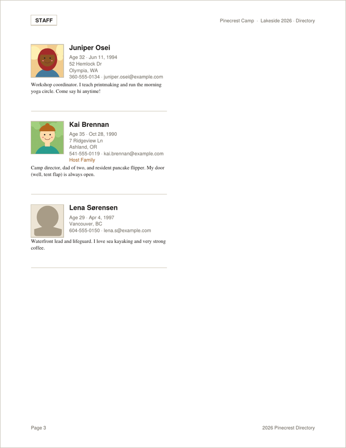</td>
  </tr>
  <tr>
    <td align="center"><em>Cover</em></td>
    <td align="center"><em>Campers</em></td>
    <td align="center"><em>Staff</em></td>
  </tr>
</table>

- **Cover page** with your camp name, subtitle, cover photo, quote, and photo credit, plus the name and subtitle in small type at the bottom.
- **Campers section**, then a fresh page for the **Staff section**. Each page has a small boxed label in the top-left corner saying CAMPERS or STAFF.
- Within each section, **everyone is sorted alphabetically by first name**, filling the left column first and then the right.
- **Two columns per page**, fitting as many people as can be read comfortably.
- Each listing contains:
  - a **square photo** (or the gray silhouette placeholder),
  - their **name** in bold,
  - their **age and birthday** (or just the birthday),
  - their **street address**, then **city and state**,
  - their **phone and email**,
  - the words **Host Family** in an orange-brown color, if they're a host family,
  - their **bio**,
  - **blank space for handwritten notes**, then a thin dividing line.
- **Page header:** the section label on the left, and the camp name and subtitle on the right.
- **Page footer:** the page number on the left, and your footer line on the right. Numbering starts at Page 1 on the first page after the cover.
- Page size is US Letter (8½ × 11 inches).

---

## Printing tips

- Print at **100% / "Actual Size."** Avoid "Fit to Page," which can shrink the text.
- **Double-sided printing** works well and halves your paper use.
- For a booklet, most print shops can take the PDF as-is and bind it with staples or a spiral.
- Do a **one-page test print** first to check the font sizes and note space feel right on paper.

---

## Troubleshooting

**The app looks broken or nothing happens when I drop a file.**
You probably opened it without an internet connection, so the helper tools didn't load. Connect to the internet and refresh the page (Mac: ⌘ Command + R; Windows: Ctrl + R).

**I can't click ahead to a later tab.**
The tabs only let you jump to steps you've already reached. Use the **Next** buttons to move forward the first time.

**I changed a font (or the title, or spacing) but the PDF didn't change.**
Go back to Step 1 and click **Next: Roster CSV →** — that's when your Step 1 settings are saved. Then generate again.

**My CSV loaded, but names or details are missing.**
Check that the first row of your CSV has the headings listed in [Preparing your roster CSV](#preparing-your-roster-csv). Re-save the file as **CSV UTF-8** if accented letters look garbled (for example, "é" instead of "é").

**Everyone ended up as a Camper (or the groups are wrong).**
The `Registrations` column must contain the word "Staff" for staff members. Look at the **Detected From** column in Step 2 to see what the app found. Fix it in the spreadsheet, or just change each person's Group dropdown.

**Lots of people show "no photo."**
- The names in the PDF might be quite different from the roster (nicknames, maiden names). Assign those photos by hand with the Photo dropdown.
- Names with accented or special letters (ø, é, ñ) may not be read correctly from a PDF. Assign those by hand.
- The PDF's names might be pictures rather than real text. Try highlighting a name in a PDF viewer — if you can't, the app can't read it either. Assign photos by hand.
- If you used a folder of photos, check that each file is named after the person (for example `Avery_Lindqvist.jpg`).

**A photo is sideways or upside down.**
Click **Edit Photo** and use **Rotate Left** or **Rotate Right**, then **Apply**.

**A photo is cropped badly (top of head cut off, etc.).**
Click **Edit Photo**, drag the square and adjust the zoom, then **Apply**.

**The finished message says some photos didn't embed.**
That photo file is probably damaged or in an unusual format. Use **Edit Photo → Import Photo** to replace it with a fresh JPG or PNG.

**Emoji disappeared from someone's bio.**
That's expected — the standard PDF fonts can't draw emoji, so they're removed to keep the PDF from breaking.

**I can't choose a folder of photos on my iPhone or iPad.**
iPhones and iPads don't support picking a whole folder in a web page. Use a photo PDF, or use a Mac or PC.

**It's slow on my iPhone or iPad.**
Very large photo PDFs take a lot of memory. Try a computer, or close other apps and browser tabs first.

**I closed the tab and lost my changes.**
Unfortunately the app can't recover them. Next time, click **Save Edits to CSV** (and **Download All Photos** if you edited photos) before closing.

---

## Frequently asked questions

**Is my data uploaded anywhere?**
No. The app reads your files inside your browser, on your own device. Nothing is sent to a server — not even when the app is hosted on GitHub Pages.

**Do I need to install anything?**
No. It's a single web page file. Just open it in a browser.

**Can I use it without internet?**
You need internet when you first open the page so it can load its PDF tools. After it's loaded, your work happens locally.

**Can I change the order (for example, sort by last name)?**
Not currently — listings are always sorted by first name within each section.

**Can I add someone who isn't in the CSV?**
Add them as a new row in your spreadsheet, re-save the CSV, and load it again in Step 2. (Tip: save your edits first so you don't lose other changes.)

**Can I use fonts other than Times New Roman, Helvetica, and Courier?**
Not at the moment. Those three are built into every PDF reader, which guarantees the directory looks identical everywhere it's opened or printed.

**Can I reuse this year's photos next year?**
Yes. Use **Download All Photos**, keep the ZIP, unzip it next year, and drop the folder into Step 3's folder area.

**Does it work for groups other than camps?**
Yes — any group with a roster and photos. Just use "Camper" and "Staff" in the Registrations column to divide people into the two sections (for example, members and leaders).

---

## Glossary

| Term | Plain-English meaning |
|---|---|
| **Browser** | The program you use to visit websites — Safari, Chrome, Firefox, Edge. |
| **CDN** | *Content Delivery Network.* A public server that hosts commonly used code so websites can load it quickly. The app uses one called cdnjs to load its PDF tools. |
| **CSV** | *Comma-Separated Values.* A plain-text spreadsheet file. |
| **Crop** | To trim a photo so only part of it shows. |
| **Fuzzy matching** | Matching names that are close but not identical, such as "Feliks" and "Felix." |
| **GitHub** | A website for storing and sharing projects like this one. |
| **GitHub Pages** | A free GitHub feature that turns files in a project into a working website. |
| **HTML** | *HyperText Markup Language.* The language web pages are written in. The whole app is one HTML file. |
| **JPG / JPEG** | *Joint Photographic Experts Group.* The most common photo file type. |
| **PDF** | *Portable Document Format.* A document file that looks the same on every device and printer. |
| **PNG** | *Portable Network Graphics.* A common image file type, often used for graphics and screenshots. |
| **Point (pt)** | A printing measurement. 72 points = 1 inch. |
| **Sans-serif** | A font without small "feet" on the letters, like Helvetica. |
| **Serif** | A font with small "feet" on the letters, like Times New Roman. |
| **Typography** | The style, size, and arrangement of text. |
| **UTF-8** | A way of saving text that handles accented and special characters correctly. |
| **ZIP** | A single compressed file that holds many files inside it. |
