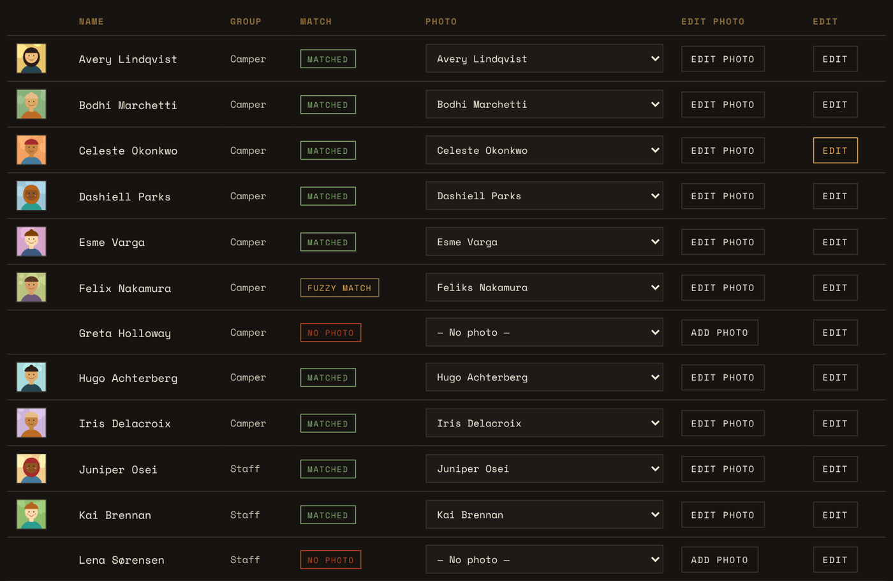
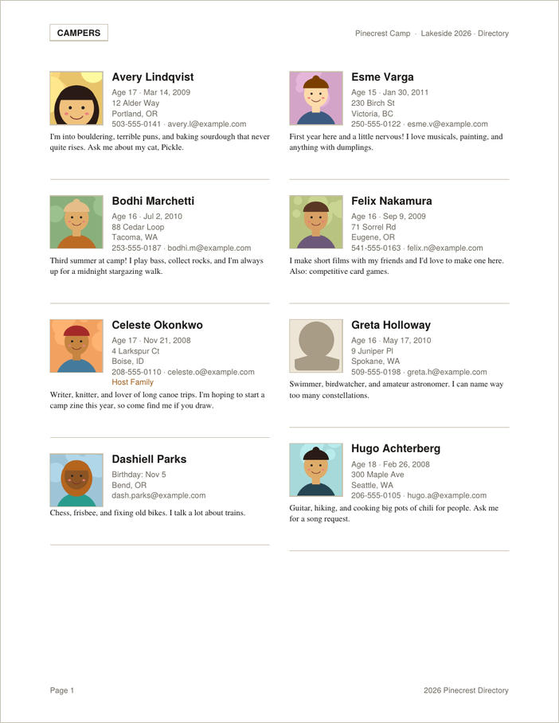
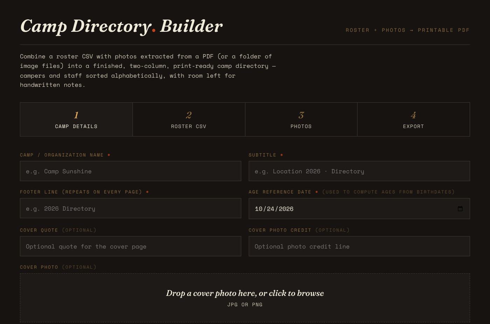

# Camp Directory Builder

**Turn a spreadsheet of names and a PDF (or folder) of photos into a finished, print-ready camp directory — right in your web browser.**

<table>
  <tr>
    <td width="58%"></td>
    <td width="42%"></td>
  </tr>
  <tr>
    <td align="center"><em>The app matches each photo to the right person…</em></td>
    <td align="center"><em>…and lays out the finished directory for printing.</em></td>
  </tr>
</table>

Camp Directory Builder was made for Not Back to School Camp (NBTSC), but it works for any camp, retreat, club, or group that wants a printed "who's who" booklet with a photo, contact details, and a short bio for every person.

You give it two things:

1. **A roster** — a spreadsheet saved as a CSV file (one row per person).
2. **Photos** — either a PDF where each person's photo appears on a page alongside their name, or a folder of photo files named after each person.

It gives you back one thing: **a polished PDF directory**, laid out in two columns, with Campers and Staff in separate sections, everyone sorted alphabetically by first name, and blank space left under each listing so people can write notes by hand once it's printed.

> **What do those letters mean?**
> - **CSV** stands for *Comma-Separated Values*. It's a plain-text version of a spreadsheet. Excel, Numbers, and Google Sheets can all save or export one ("File → Export → CSV" or "Download → .csv").
> - **PDF** stands for *Portable Document Format*. It's the standard file type for documents meant to be printed or shared and look the same on every computer.

*All screenshots in this README and the manual use made-up sample people, not real campers.*

---

## Highlights

- **Four simple steps** — Camp Details → Roster CSV → Photos → Export. A tab bar across the top shows where you are.
- **Automatic Camper / Staff sorting** — the app reads each person's registration info and figures out which group they belong to. You can change anyone with a dropdown.
- **Automatic photo matching** — the app pulls each photo out of your PDF, reads the name printed on the same page, and attaches the photo to the right person. It tolerates small typos ("Feliks" vs "Felix"). You can also drop in a folder of photos named after each person.
- **Photo editor** — crop, zoom, rotate, or swap in a different photo for anyone.
- **Listing editor** — fix a typo, update an email, or rewrite a bio without going back to the spreadsheet.
- **Save your edits** — export everything you changed back out as a new CSV so you never lose your work.
- **Download all photos** — get every cropped, rotated photo as a single ZIP file (a compressed folder).
- **Your choice of fonts and sizes** for names, details, bios, section labels, and page headers/footers.
- **Adjustable spacing** between listings.
- **Placeholder silhouette** for anyone without a photo (can be turned off).
- **Ages calculated for you** from birthdates, as of whatever date you choose.
- **Private by design** — everything happens on your own computer. Nothing is uploaded to any server.
- **Works in Safari** on Mac, iPhone, and iPad, as well as Chrome, Firefox, and Edge.

---

## Quick start

1. **Download** `camp-directory-builder.html` from this repository (click the file, then the download button — the little arrow pointing down).
2. **Double-click** the file. It opens in your web browser. There's nothing to install.
3. **Step 1 – Camp Details:** type your camp name, subtitle, and footer text. Optionally add a cover photo and quote.
4. **Step 2 – Roster CSV:** drag your roster CSV onto the drop area (or click it to browse). Check the Camper/Staff list.
5. **Step 3 – Photos:** drag in your photo PDF (or a folder of photos). Wait while the app matches photos, then fix anyone marked "No Photo."
6. **Step 4 – Export:** click **Generate Directory PDF**. Your finished directory downloads to your Downloads folder.

📖 **For full, step-by-step instructions with pictures of every screen, see the [User Manual](MANUAL.md).**

---

## What your roster CSV should look like

The first row of your CSV must be column headings. The app looks for these names:

| Column heading | What goes in it | Required? |
|---|---|---|
| `First Name` | Person's first name | Yes |
| `Last Name` | Person's last name | Yes |
| `Date of Birth` | Full date (e.g. `2006-12-21`) or month and day only (e.g. `10-09`) | No |
| `Registrations` | Text that includes the word "Camper" or "Staff" | Recommended |
| `GI Address` | Street address | No |
| `GI City` | City | No |
| `GI State/Province` | State or province | No |
| `GI Email` | Email address | No |
| `GI Phone` | Phone number | No |
| `GI Host Family` | "Yes" if the person is a host family | No |
| `GI Directory Bio` | The short paragraph the person wrote about themselves | No |

("GI" comes from the registration system NBTSC uses — it just means "General Information." The app also recognizes simpler headings like `Email`, `City`, or `Bio`, but the names above are the safest choice.)

See the [User Manual](MANUAL.md#preparing-your-roster-csv) for more detail and 

---

## What's in this repository

| File or folder | What it is |
|---|---|
| `camp-directory-builder.html` | The entire app, in one file. |
| `README.md` | This page — an overview. |
| `MANUAL.md` | The full user manual with step-by-step instructions, tips, and troubleshooting. |
| `screenshots/` | The pictures used in this README and the manual (made with invented sample data). |

---

## How it works behind the scenes

You don't need to know any of this to use the app, but for the curious:

- The app is a single web page written in **HTML** (*HyperText Markup Language* — the language web pages are built from), **CSS** (*Cascading Style Sheets* — which control how the page looks), and **JavaScript** (the programming language that makes web pages interactive).
- It uses three free, widely used open-source helper libraries, loaded from **cdnjs**, a **CDN** (*Content Delivery Network* — a fast, reliable public server that hosts common code):
  - **[PDF.js](https://mozilla.github.io/pdf.js/)** (by Mozilla, the makers of Firefox) — reads your photo PDF and pulls out the images and text.
  - **[pdf-lib](https://pdf-lib.js.org/)** — builds the finished directory PDF.
  - **[JSZip](https://stuk.github.io/jszip/)** — packages photos into a ZIP file for the "Download All Photos" feature.
- Because those helpers are downloaded when the page opens, **you need an internet connection when you first open the app.** Your own files still never leave your computer.

---

## Privacy

Camp directories contain children's names, photos, addresses, and phone numbers. This app was built so that information stays where it belongs:

- No account, no login, no tracking.
- Files you drop into the app are read by your browser and stay in your computer's memory.
- When you close the browser tab, everything the app was holding is gone.
- The only files that come out are the ones *you* choose to download (the directory PDF, the edits CSV, or the photos ZIP).

Please still handle the finished PDF with care — share it only with the people it's meant for, and never upload a real roster or directory to this repository.

---

## Browser support

| Browser | Works? |
|---|---|
| Safari (Mac) | ✅ |
| Safari (iPhone / iPad) | ✅ — use a photo PDF (picking a whole folder isn't supported on iPhone/iPad); large rosters may be slower on older devices |
| Chrome | ✅ |
| Firefox | ✅ |
| Microsoft Edge | ✅ |

---

## License

*Add your chosen license here.* If you'd like others to be free to use and adapt this, the **MIT License** is a simple, popular choice — GitHub can add it for you: **Add file → Create new file**, name it `LICENSE`, then click **Choose a license template**.

---

## Credits

Built for Not Back to School Camp, with thanks to the campers and staff whose directories inspired it.
